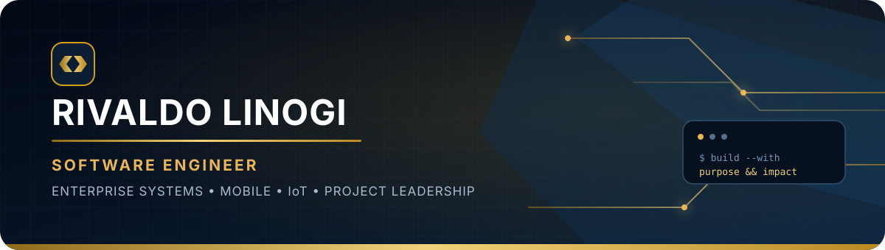

<!--
  GitHub Profile README for @rivlin07
  Theme: Dark Navy + Gold
-->

<div align="center">
  
</div>

<div align="center">
  <a href="https://github.com/rivlin07">
    
  </a>
  <a href="https://www.rodajayasakti.id">
    
  </a>
  
</div>

<br />

## About Me

```yaml
name: Rivaldo Linogi
role: Software Engineer · IT System Development
location: Makassar, Indonesia
focus:
  - Enterprise systems & HRIS
  - Cross-platform mobile applications
  - IoT, GPS & vehicle telemetry
  - Project leadership & system architecture
mission: Turn operational challenges into reliable digital products.
```

I design and build practical technology for real operational environments—from enterprise web systems and cross-platform mobile apps to connected hardware in the field. My work sits at the intersection of **software engineering, IoT, and project leadership**, with a strong focus on solutions that are useful, maintainable, and ready for production.

## What I Build

<table>
  <tr>
    <td width="50%" valign="top">
      <h3>🏢 Enterprise Systems</h3>
      HRIS, attendance, employee workflows, dashboards, approvals, and operational automation for multi-site organizations.
    </td>
    <td width="50%" valign="top">
      <h3>📱 Mobile Applications</h3>
      Cross-platform Android and iOS applications with offline-first workflows, GPS, photo capture, and background synchronization.
    </td>
  </tr>
  <tr>
    <td width="50%" valign="top">
      <h3>📡 IoT & Telematics</h3>
      GPS tracking, fuel-level telemetry, MQTT data pipelines, embedded devices, and vehicle monitoring solutions.
    </td>
    <td width="50%" valign="top">
      <h3>🧭 Project Leadership</h3>
      Translating business needs into architecture, delivery plans, team priorities, and measurable digital transformation.
    </td>
  </tr>
</table>

## Technology & Tools

<div align="center">

**Languages**


**Web & Mobile**


**Data & Infrastructure**


**IoT & Engineering**

<br />


</div>

## Selected Work

<table>
  <tr>
    <td width="33%" valign="top">
      <h3>Attendance Management</h3>
      Multi-site attendance platform for Android, iOS, and web with geofencing, offline capture, approvals, and reporting.
      <br /><br />
      <code>Flutter</code> <code>Web</code> <code>GPS</code>
    </td>
    <td width="33%" valign="top">
      <h3>SIRAJA / HRIS</h3>
      An enterprise HR ecosystem designed as a central hub for employee data, workflows, coaching, and learning.
      <br /><br />
      <code>HRIS</code> <code>Architecture</code> <code>Workflow</code>
    </td>
    <td width="33%" valign="top">
      <h3>Vehicle Telemetry</h3>
      GPS and fuel monitoring for heavy equipment using cellular connectivity, custom electronics, and real-time MQTT.
      <br /><br />
      <code>ESP32</code> <code>SIM7600</code> <code>MQTT</code>
    </td>
  </tr>
</table>

> Some projects are developed for internal company operations, so their source code is private. I share architecture notes and public-safe components whenever possible.

## GitHub Analytics

<div align="center">
  
  
</div>

<div align="center">
  
</div>

## Contribution Journey

<div align="center">
  
</div>

---

<div align="center">
  <h3>Build with purpose. Lead with clarity. Keep improving.</h3>
  <sub>Software should make real work simpler, faster, and more reliable.</sub>
  <br /><br />
  <a href="https://github.com/rivlin07?tab=repositories">
    
  </a>
</div>

